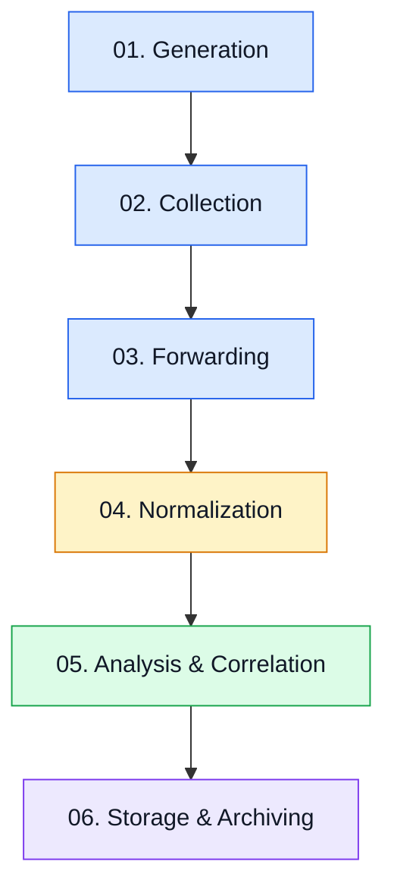

# 📚 Common Log Formats & Log Lifecycle


> Different Tools, Different Formats, Same Insight.  
> Understanding how logs are generated, collected, processed, and analyzed in a SOC environment.

**Learning Date:** 26 November 2026

---

## 📑 Table of Contents

1. Introduction
2. Common Log Formats
3. Log Lifecycle & Flow
4. Understanding Each Lifecycle Stage
5. Practical Examples
6. Key Takeaways
7. Learning Progress

---

## 1. Introduction

Logs are generated by different systems, applications, network devices, and security tools.

However, different tools may store or represent log data in different formats.

A SOC analyst should understand:

- How log data is structured.
- Where logs originate.
- How logs are collected and forwarded.
- How logs are normalized.
- How SIEM tools analyze and correlate events.

**Important Concept:**

Different log formats can contain similar information but represent it in different structures.

---

## 2. Common Log Formats

### Log Format Comparison

| Format | Full Form / Description | Common Usage |
|---|---|---|
| Syslog | Standard logging format and protocol | UNIX/Linux systems, network devices |
| JSON | JavaScript Object Notation; structured key-value format | Modern applications, SIEM tools, cloud services |
| CSV | Comma-Separated Values | Data export, reporting, log analysis |
| CEF | Common Event Format | ArcSight and many security tools |
| LEEF | Log Event Extended Format | IBM QRadar |

### 2.1 Syslog

**Description:** A standard logging mechanism widely used by UNIX/Linux systems and network devices.

**Common Sources:**
- Linux servers
- Routers
- Switches
- Firewalls

**Example:**

```text
Nov 26 10:30:15 server sshd: Failed password for admin from 192.168.1.10
```

**SOC Relevance:**
- Monitor system events.
- Investigate failed login attempts.
- Identify suspicious network activities.

### 2.2 JSON

**Full Form:** JavaScript Object Notation

**Description:** A structured format that stores information using key-value pairs.

**Common Sources:**
- Modern applications
- Cloud services
- APIs
- SIEM platforms

**Example:**

```json
{
  "timestamp": "2026-11-26T10:30:15Z",
  "username": "admin",
  "source_ip": "192.168.1.10",
  "event": "failed_login",
  "status": "failure"
}
```

**SOC Relevance:**
- Easy to parse and search.
- Extract specific event fields.
- Analyze user and IP activities.

### 2.3 CSV

**Full Form:** Comma-Separated Values

**Description:** A tabular format that stores data in rows and columns.

**Common Sources:**
- Applications
- Security tools
- Reporting systems
- Data exports

**Example:**

```csv
timestamp,username,source_ip,event,status
2026-11-26 10:30,admin,192.168.1.10,failed_login,failure
```

**SOC Relevance:**
- Import and export log data.
- Perform basic log analysis.
- Create reports and identify patterns.

### 2.4 CEF

**Full Form:** Common Event Format

**Description:** A standardized event format developed by ArcSight and used by many security tools.

**Common Usage:**
- Security devices
- Firewalls
- IDS/IPS
- SIEM integrations

**Example:**

```text
CEF:0|SecurityVendor|Firewall|1.0|1001|Failed Login|5|src=192.168.1.10 suser=admin
```

**SOC Relevance:**
- Standardizes security event fields.
- Helps integrate different security products.
- Makes security events easier to process.

### 2.5 LEEF

**Full Form:** Log Event Extended Format

**Description:** A structured event format commonly associated with IBM QRadar.

**Common Usage:**
- IBM QRadar
- Security appliances
- Enterprise security tools

**Example:**

```text
LEEF:2.0|Vendor|Product|1.0|1001|src=192.168.1.10	username=admin	event=failed_login
```

**SOC Relevance:**
- Helps integrate security event sources.
- Provides structured event information.
- Supports SIEM event processing.

---

## 3. Log Lifecycle & Flow

**From Log Generation to Analysis**

The log lifecycle describes how an event travels from its original source to a SIEM platform, where security analysts investigate it.

### Log Processing Workflow



### 3.1 Generation

**What happens?**

A user or system performs an activity, and a log event is generated.

**Examples:**
- User login attempt.
- File modification.
- Application error.
- Network connection.

### 3.2 Collection

**What happens?**

Agents or log collectors collect events from different sources.

**Common Tools:**
- Wazuh Agent
- Filebeat
- Winlogbeat
- Syslog

**Purpose:** Gather logs from multiple systems into a central environment.

### 3.3 Forwarding

**What happens?**

Collected logs are forwarded to a central server or SIEM platform for processing.

**Purpose:**
- Centralized log management.
- Continuous monitoring.
- Security event processing.

### 3.4 Normalization

**What happens?**

Logs from different sources are converted or mapped into a consistent structure so they can be searched and analyzed together.

**Examples:**
- Elastic Common Schema (ECS)
- CEF
- LEEF

**Purpose:**
- Maintain consistency.
- Standardize event fields.
- Simplify log analysis.

*Note: ECS is a common data schema, while CEF and LEEF are event formats.*

### 3.5 Analysis & Correlation

**What happens?**

SOC analysts and SIEM tools search, monitor, and correlate logs to identify suspicious activities.

**Examples:**
- Multiple failed login attempts.
- Unusual login locations.
- Suspicious network connections.
- Potential malware activity.

**Purpose:** Detect threats and generate security insights.

### 3.6 Storage & Archiving

**What happens?**

Logs are stored for incident investigation, compliance requirements, and long-term retention.

**Purpose:**
- Incident response.
- Historical investigation.
- Compliance audits.
- Future threat analysis.

---

## 4. Practical Examples

### Scenario: Multiple Failed Login Attempts

Imagine a user account receives several failed login attempts from an unknown IP address.

| Lifecycle Stage | Activity |
|---|---|
| Generation | Failed login event is generated. |
| Collection | An agent collects the authentication log. |
| Forwarding | The event is forwarded to the SIEM. |
| Normalization | Event fields are mapped into a consistent structure. |
| Analysis | SIEM identifies repeated failed login attempts. |
| Storage | Events are retained for investigation. |

**SOC Analyst's Objective:** Investigate whether the activity indicates a brute-force attack or another suspicious login pattern.

---

## 5. Key Takeaways

- Different tools generate logs in different formats.
- Syslog is widely used in Linux environments and network devices.
- JSON provides structured key-value data.
- CSV organizes data into rows and columns.
- CEF and LEEF are commonly used for security event integration.
- Log collection gathers events from different sources.
- Forwarding sends logs to a central platform.
- Normalization makes different log structures consistent.
- SIEM analysis and correlation help detect suspicious activities.
- Storage supports incident investigation and compliance.

> **"Understand the Journey of a Log."**  
> Continuous Monitoring Today for a Safer Tomorrow.

---

## 6. My Learning Progress

- [✅] Understand common log formats.
- [✅] Identify Syslog, JSON, CSV, CEF and LEEF.
- [✅] Understand the log lifecycle.
- [✅] Learn the six stages of log processing.
- [ ] Practice collecting logs using Wazuh.
- [ ] Explore log analysis in a SIEM.
- [ ] Practice event correlation and threat detection.

---

**Learning Track:** SOC Analyst Level 1  
**Category:** Log Management & SIEM Fundamentals  
**Purpose:** Personal cybersecurity learning, practical understanding, and technical revision.
